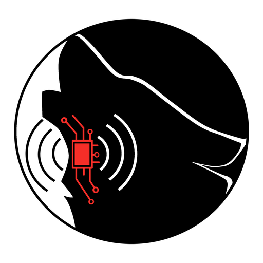
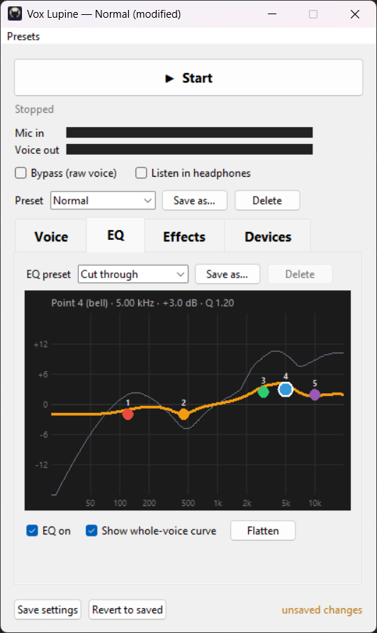
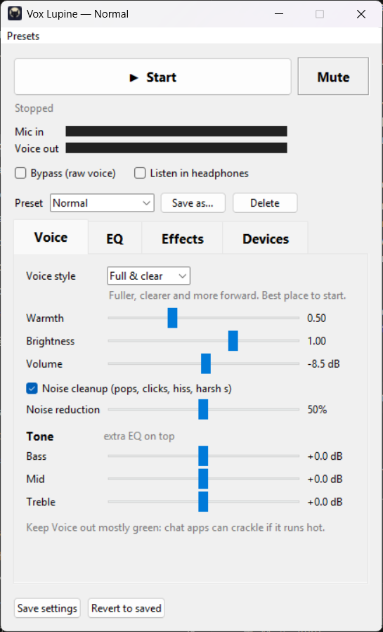
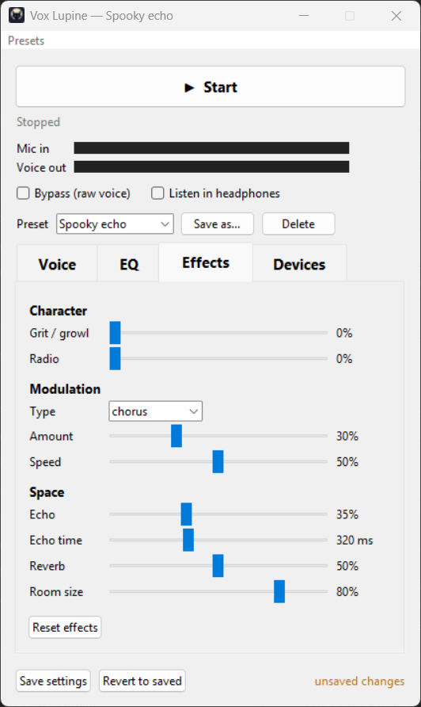
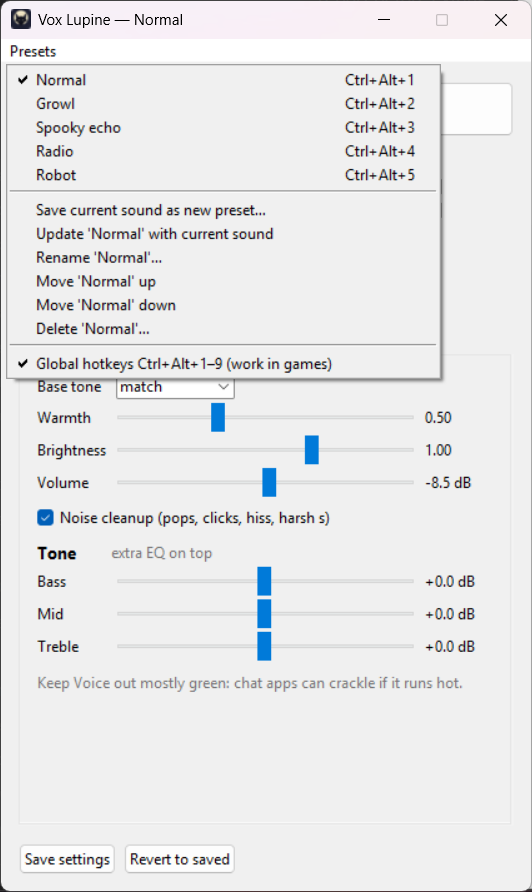
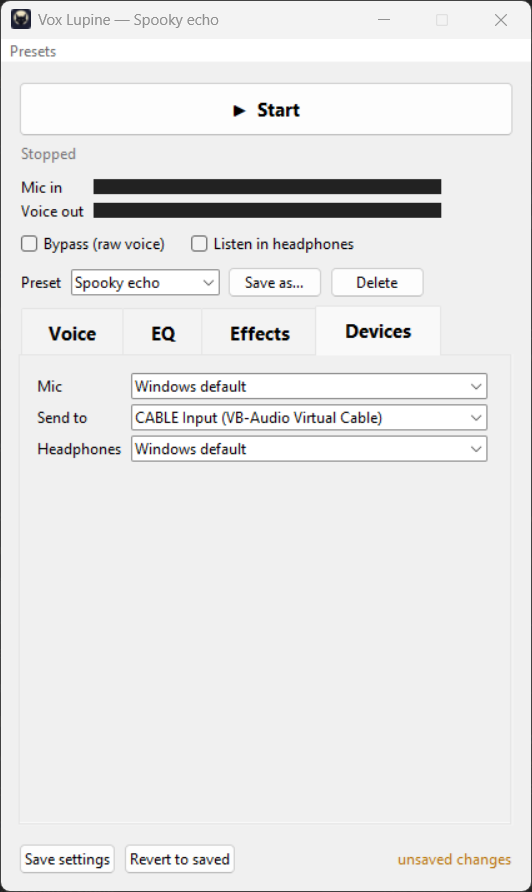

<p align="center">
  
</p>

<h1 align="center">Vox Lupine</h1>

A small Windows app that cleans up and styles your microphone **in real time** and
sends it to a virtual mic, so OBS, Discord, games and chat apps all hear the
processed voice. Made with streamers and PNGtubers in mind.

- **Cleanup:** rumble filter, de-popper for plosives, de-esser, **noise reduction** that
  removes steady background noise (fans, PC hum, hiss) even while you talk, and a smart
  noise gate that ignores keyboard clicks
- **Tone:** warmth, brightness, a choice of voice styles, and bass/mid/treble
- **Draggable 5-point EQ** with a live curve, plus built-in EQ presets for speech
- **Effects:** grit/growl, radio, chorus/vibrato/flanger/phaser/tremolo/robot, echo, reverb
- **Presets:** save whole sounds and switch with **Ctrl+Alt+1–9 from anywhere**, even while a game has focus
- **No pitch shifting**, so there are no robotic artifacts. Total delay is about 70 ms on a typical setup.

It runs on your CPU and uses well under 1 ms per 5 ms audio chunk.

<p align="center">
  
</p>

<details>
<summary><b>More screenshots</b></summary>
<br>

| Voice | Effects |
|---|---|
|  |  |
| **Presets menu** | **Devices** |
|  |  |

</details>

---

## Common issues

**No audio coming through your microphone?**
Vox Lupine shows a red warning when your mic delivers no sound, with buttons that open
the right Windows settings. Check your input device in Windows' sound settings first:

1. Open **Settings → System → Sound** and look under **Input**.
2. Make sure your **real microphone** is selected (not "CABLE Output"), and that the
   level bar moves when you talk. If it doesn't, raise the **Input volume** or click the
   mic to check that it isn't muted or disabled.
3. Check **Settings → Privacy & security → Microphone**: **Microphone access** and
   **Let desktop apps access your microphone** must both be **on**.
4. In Vox Lupine, open the **Devices** tab and make sure **Mic** is that same microphone,
   or **Windows default**. The **Mic in** meter should move when you talk.

**Your voice isn't reaching OBS or Discord?** Set the microphone in that app to
**CABLE Output (VB-Audio Virtual Cable)**, make sure Vox Lupine says **Running**, and
check that **Send to** on the Devices tab is **CABLE Input**.

**Fan, hum or hiss in the background?** Raise **Noise reduction** on the Voice tab
(Noise cleanup must be on). It handles steady noise; sudden sounds like keyboard clicks
are left to the noise gate between words.

**Static or crackle while talking** (Discord, Telegram, etc.)? Lower **Volume** on the
Voice tab a few dB and keep the **Voice out** meter mostly green.

**Headset un-mutes itself when you press Start?** Some wireless headsets (Corsair, for
example) reset their own mute button whenever an app starts recording. Vox Lupine can't
change that, so use Vox Lupine's **Mute** button or **Ctrl+Alt+0** instead: it silences
everything you send, whatever the headset does.

**"Windows protected your PC" when installing?** The installer isn't code-signed. Click
**More info → Run anyway**.

More fixes are in [Troubleshooting](#troubleshooting).

---

## Install

You need Windows 10 or 11 and [VB-Cable](https://vb-audio.com/Cable/), the free
virtual audio cable Vox Lupine sends your voice to.

1. **Install VB-Cable.** Download the driver pack from vb-audio.com/Cable, extract it,
   right-click **`VBCABLE_Setup_x64.exe` → Run as administrator → Install Driver**, then
   **restart your PC**.
2. **Download `VoxLupine-Setup-x.y.z.exe`** from the
   [**Releases**](../../releases/latest) page and run it. No admin rights are needed,
   and nothing else needs installing because Python is built in.
   - Windows may show *"Windows protected your PC"* because the installer isn't
     code-signed. Click **More info → Run anyway**.
3. Open **Vox Lupine** from the Start menu or desktop.
4. On the **Devices** tab, check that **Mic** is your microphone and **Send to** is
   **CABLE Input (VB-Audio Virtual Cable)**. Then press **Start**.

To uninstall, use Windows Settings → Apps. Your settings and presets in
`%APPDATA%\Vox Lupine` are kept, so delete that folder too if you want them gone.

<details>
<summary><b>Run from source instead</b> (needs Python)</summary>

1. Install [Python 3.11 or newer](https://www.python.org/downloads/). In its installer,
   tick **"Add python.exe to PATH"** and keep **"tcl/tk and IDLE"** selected.
2. Download this repository (**Code → Download ZIP**, or `git clone`).
3. Double-click **`setup.bat`**. It creates a private Python environment in `.venv` and
   installs the libraries. This is needed only once.
4. Double-click **`Vox Lupine.bat`** to open the app.

When run from source, settings are stored next to the code instead of in `%APPDATA%`.
</details>

## Connect your apps

Set the microphone in each app to **CABLE Output (VB-Audio Virtual Cable)**:

- **OBS:** add an *Audio Input Capture* source with device **CABLE Output**, and remove
  or mute your old mic source so viewers don't hear both.
- **Discord:** Settings → Voice & Video → Input Device → **CABLE Output**.
- **Games and other apps:** choose **CABLE Output** as the mic.

To hear yourself, tick **Listen in headphones**. A small volume slider appears next to
it; it only changes what *you* hear, not what your apps get. There's a slight delay,
which is normal for any live voice processing.

> **PNGtuber tip:** point your avatar app (veadotube, PNGTuber Plus, etc.) at your
> **real microphone**, not CABLE Output, so mouth movement reacts instantly. If the
> mouth moves a little before your voice on stream, add about 70 ms of *Sync Offset*
> to the CABLE Output source in OBS (Edit → Advanced Audio Properties).

## Using the app

**Top area** (always visible)
- **Start / Stop**, plus the status line: delay, CPU use and a **glitch counter**
- **Mute** (or **Ctrl+Alt+0** from anywhere) silences everything you send, to your apps
  and your headphones. It turns red while muted and stays muted across Stop/Start;
  the app always opens unmuted.
- **Mic in / Voice out** meters
- **Bypass** hears your raw voice for A/B comparison
- **Listen in headphones**, with its own volume slider while it's on
- **Preset** dropdown, and the **Presets** menu in the menu bar

**Voice tab**
- **Voice style** is the starting sound everything else builds on. A short description
  appears under it when you pick one:
  - **Full & clear** (default): fuller, clearer and more forward. Best place to start.
  - **Light polish**: a gentler version for when Full & clear is too much.
  - **Husky**: Full & clear plus a soft, smoky rasp.
  - **Off**: your mic as it is, with no shaping or levelling, so it's quieter.
- **Warmth**, **Brightness**, **Volume**, **Noise cleanup** on/off, and **Bass / Mid /
  Treble** for extra tone on top.
- **Noise reduction** sets how hard steady background noise is pushed down (default
  50%). It learns your room's noise while you're quiet, so give it a second or two after
  Start, and stay quiet for a moment if the noise changes (a fan turning on). Very high
  settings can make the background sound a little watery.

**EQ tab:** a 5-point EQ on a graph.
- Drag a point left/right to change frequency and up/down to boost or cut.
- Use the mouse wheel on a point to make it wider or narrower.
- Double-click a point to reset it.
- **EQ preset** has built-in shapes for speech (Clean & clear, Cut through, Warm & full,
  Less nasal, Soft / less harsh, Airy sparkle, Big & deep, Distant). **Save as…**
  stores your own.
- The grey line shows the overall tone shape of the whole voice chain.

**Effects tab:** grit/growl, radio, modulation (type, amount, speed), echo and reverb.
Everything defaults to off. **Reset effects** turns it all off again.

**Presets** (menu bar)
- Click a preset to switch to it. The first nine also have **Ctrl+Alt+1–9**, which
  work system-wide, like **Ctrl+Alt+0** for mute (you can turn them off in the menu).
- **Save current sound as new preset**, **Update**, **Rename**, **Move up/down** (this
  changes its number) and **Delete**.
- The window title shows the active preset and adds "(modified)" after you change it.
- On first run you get a few starters to play with (Normal, Growl, Spooky echo,
  Radio, Robot). Edit or delete them freely.

**Save settings** remembers everything for next time. **Revert to saved** undoes
experiments.

## Tips

- **Keep "Voice out" mostly green.** Chat apps with automatic gain control (Discord,
  Telegram, etc.) can turn very loud peaks into crackle or static. The default volume
  of −8.5 dB leaves room for that. If you hear static only while talking, lower
  **Volume** a few dB.
- Big boosts on the bass/mid/treble sliders or the EQ add up. If the meter turns
  yellow or red, lower Volume to compensate.

## Troubleshooting

| Problem | Fix |
|---|---|
| "No output device matching 'CABLE Input'" | VB-Cable isn't installed. Install it as administrator and restart. To test without it, set **Send to** to your headphones. |
| Clicks or dropouts; the glitch counter keeps rising | Close other heavy programs and try again. If it persists, please open an issue. If you run from source, `.venv\Scripts\python.exe tools\diag_buffer.py 30` finds a buffer size that works on your devices; set it in `PREFILL_BLOCKS` / `MAX_BUFFER_BLOCKS` in `engine.py`. Bigger values mean fewer glitches but a little more delay. |
| "The mic is set to 'CABLE Output'…" | The mic can't be the virtual cable itself, because that would loop your voice back in. Pick your real microphone on the Devices tab. (Installing VB-Cable sometimes makes CABLE Output the Windows default mic. The app skips it automatically when Mic is set to "Windows default".) |
| Static only while talking (Discord, Telegram, etc.) | Lower **Volume** (see Tips). |
| A Ctrl+Alt hotkey doesn't work | Another program already uses it. The app tells you which when you switch hotkeys on in the Presets menu. |
| The app doesn't open | Installed: run the installer again. From source: run `setup.bat` again; to see error messages, run `.venv\Scripts\python.exe app.py` from a terminal. |

## Command line (from source)

```
.venv\Scripts\python.exe live.py              run the filter without the window
.venv\Scripts\python.exe live.py --list       list audio devices
.venv\Scripts\python.exe live.py --monitor    also play into your headphones
.venv\Scripts\python.exe live.py --selftest   check the live path matches offline processing
```

Checks you can run: `tests\test_eq_accuracy.py` (the EQ graph matches the real audio)
and `tests\test_no_static.py` (no stage adds noise).

## How it works

```
mic → cleanup → warmth → brightness → voice style → bass/mid/treble → 5-point EQ
    → effects → volume → soft safety ceiling → VB-Cable (+ optional headphones)
```

Audio is processed in 256-sample blocks (5.3 ms at 48 kHz) with
[pedalboard](https://github.com/spotify/pedalboard). Slider changes are queued and
applied at the start of the next block. A small buffer between the mic and VB-Cable
absorbs timing differences between the two devices.

| File | What it is |
|---|---|
| `app.py` | The window |
| `engine.py` | Audio devices, buffering and settings |
| `presets.py` | The voice chain and voice styles |
| `cleanup.py`, `denoise.py`, `warmth.py`, `bright.py`, `fx.py`, `peq.py` | Processing stages |
| `eqgraph.py` | The EQ tab |
| `hotkeys.py` | Global Ctrl+Alt+1–9 |

Settings are saved in `config.json`, `scenes.json` (presets) and `eq_presets.json`.
The installed app keeps them in `%APPDATA%\Vox Lupine`; from source they sit next to
the code (and are ignored by git).

## Building the installer

```
powershell -ExecutionPolicy Bypass -File tools\build_installer.ps1
```

This needs Python 3.11+ and [Inno Setup 6](https://jrsoftware.org/isinfo.php)
(`winget install JRSoftware.InnoSetup`). The script makes its own `.build-venv`,
bundles the app with [PyInstaller](https://pyinstaller.org/), and writes
`dist\VoxLupine-Setup-<version>.exe`. The version number lives in `about.py`. Attach
the installer to a GitHub Release rather than committing it.

## License

GPL-3.0. See [`LICENSE`](LICENSE) and [`THIRD_PARTY_NOTICES.md`](THIRD_PARTY_NOTICES.md).
VB-Cable is a separate product by VB-Audio and is not included. This project is not
affiliated with VB-Audio, Spotify or any app mentioned here.
